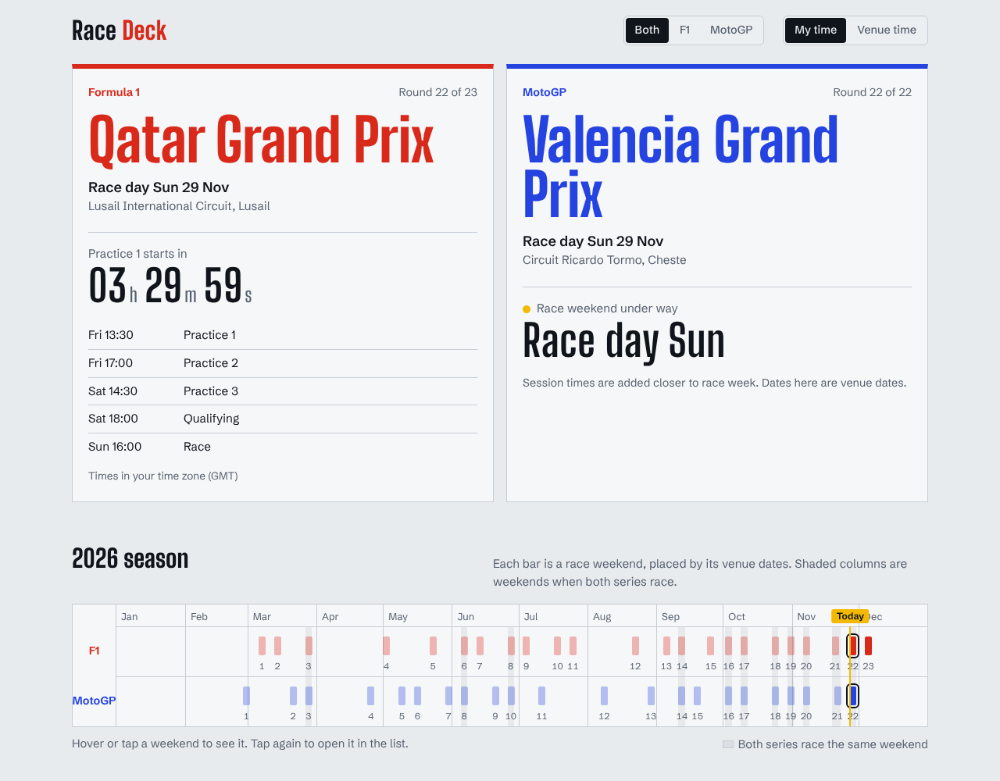
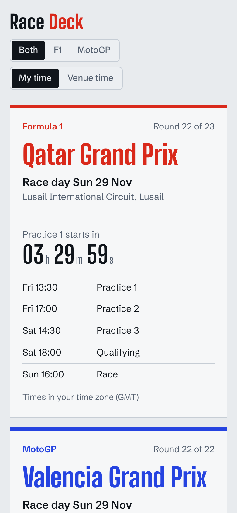

# Race Deck

One calendar for Formula 1 and MotoGP. See the next race of each series, every session in your own time zone, both seasons on a single timeline, past results and the championship standings.

**Live site:** https://race-calendar-widget.vercel.app



## What it does

- **Next up, per series.** Race name, race day, a live countdown to the next session and the full weekend timetable, in your time zone or the venue's (switch at the top).
- **Both series on one timeline.** F1 and MotoGP sit in two lanes on the same season axis. Shaded columns mark weekends when both race.
- **Race day, not Friday.** Every date in the list is race day at the venue, the way official calendars quote it. The weekend range is in each race's detail.
- **Results and standings.** Open any completed race for the podium; standings for both series are below the calendar.
- **Add to calendar.** Each weekend downloads as an `.ics` file: timed sessions once a timetable is published, one all-day block before that.
- **Installable.** Works as a home-screen app on phones.



## How dates work

Every date and time is handled as a UTC instant, and nothing compares a date string to your clock.

- `data/races.json` holds venue-local dates (`start`, `raceDate`) and the venue's IANA time zone (`tz`).
- A weekend begins at its first published session, or at venue-local midnight of day one when no timetable exists yet. It ends one hour after the last session, or at venue-local midnight after race day.
- `lib/time.ts` converts venue-local wall-clock times to UTC with `Intl`, including daylight-saving edges. Tests in `tests/time.test.ts` cover Las Vegas, Melbourne, Adelaide, Kolkata and the DST switch.
- A race stays "live" through its sessions even after the calendar date has rolled over where you are.

## Updating the data

Everything lives in `data/`:

| File | What |
| --- | --- |
| `races.json` | Both series, 2026 and 2027. Add a `sessions` array of `{ name, utc }` when the official timetable is published. Add a `result` object after a race. |
| `standings.json` | Championship tables, plus which round each is "through". |
| `tracks.json` | Circuit outlines used in the race detail. |

After editing, run `npm test`. It checks that race days fall on weekends, that session times land inside the weekend in venue time, and that ids are unique.

## Develop

```bash
npm install
npm run dev        # http://localhost:3000
npm test           # date and data checks
npm run build
```

Deployed on Vercel as a Next.js app (`vercel.json`).

## macOS desktop widget

`race-calendar.widget/` is an Übersicht widget. Its `calendar-data.json` is generated from the same data:

```bash
npm run widget
```

## License

MIT
