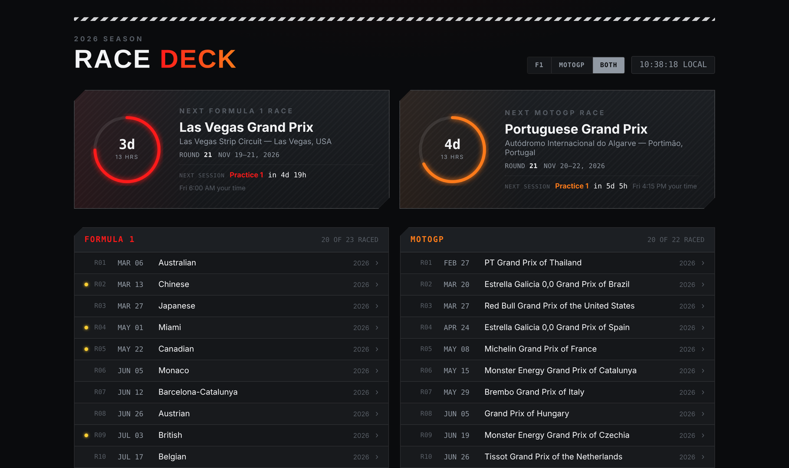
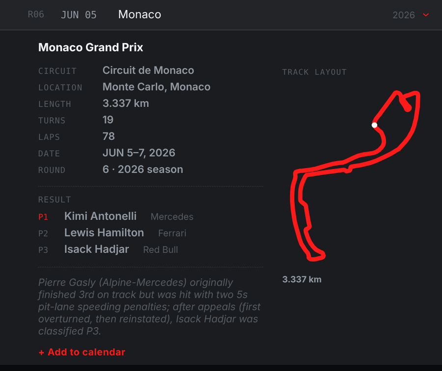
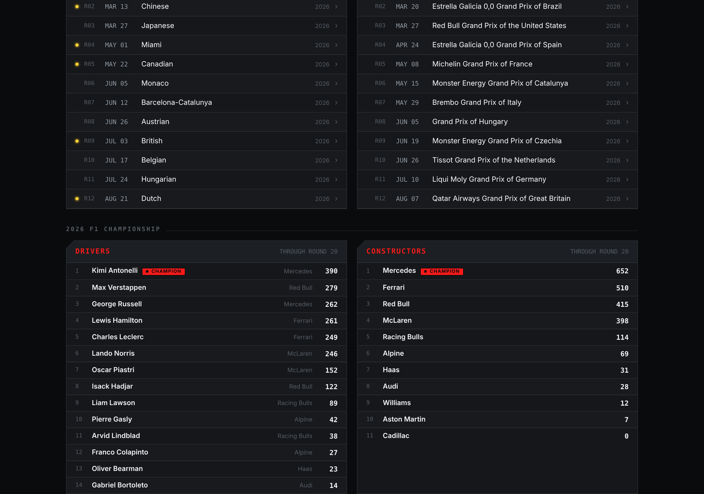
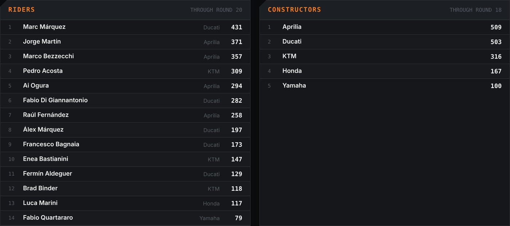
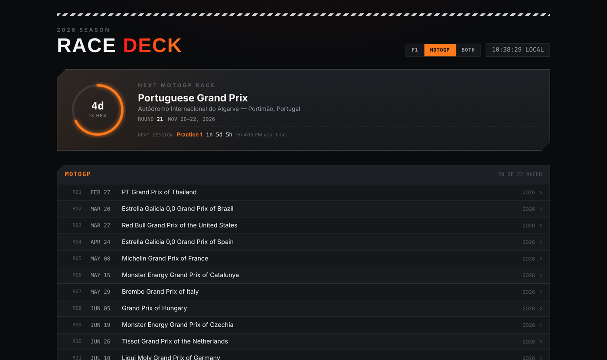
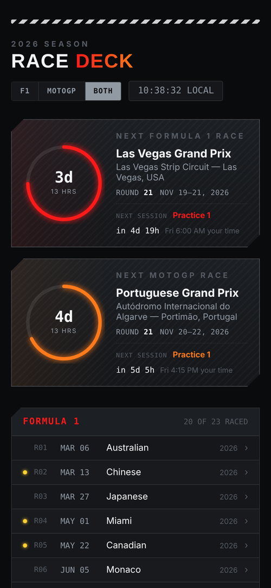

# Race Deck — F1 + MotoGP Race Calendar

Checking two different apps for two different race calendars, every single
week, got old. So this is the fix: **one page, zero dependencies, zero
install**, that tracks both the Formula 1 and MotoGP seasons — next race,
full remaining schedule, every finished race's result, and the live
championship standings — all in one dark, data-dense screen built the way
a timing screen is built, not a dashboard.

No account. No app. No build step. No ads, no tracking, no backend. It's a
single HTML file you can open directly in a browser, and it works offline
once it's loaded.

  



## Use it

**→ [Open the live page](https://race-calendar-widget.vercel.app/)**

That's it — works on desktop, phone, or tablet, in any modern browser.
Nothing to download, no third-party app, no sign-up.

Prefer it local? Download [`docs/index.html`](docs/index.html) and
double-click it. It runs fully offline except for its Google Fonts
(Orbitron + Inter), and it's installable as a PWA — on a phone, "Add to
Home Screen" turns it into a real app icon.

## What you get

**A live countdown to your next race.** For F1 and MotoGP each: a ring
counter to the race weekend, which session is up next, and when it starts
in your own timezone. During a race weekend it switches to a live "race
week" state.

**Every round, past and future, with real results.** Click any race that's
already happened and its panel opens with the actual outcome — winner,
full P1/P2/P3 podium with each driver's or rider's team, sprint winner
where there was one, and a note for anything that needs context (a
post-race penalty, a reclassification, a cancellation). Nothing is hidden
behind a second click or a different page.

| Race detail — podium, teams, and a real GPS-derived track map |
|---|
|  |

**Real track maps**, not stock photos — each circuit's layout is drawn
from its actual GPS coordinates, shown to scale with its length.

**Live championship standings** for both series — Drivers/Riders and
Constructors — each one labeled with exactly which round it's current
through, rather than quietly going stale. (MotoGP's constructor standings
lag the rider standings by design: MotoGP only scores the best-placed
bike per manufacturer per race, so it can't be derived from rider points
and has to be tracked on its own cadence.)

| F1 standings | MotoGP standings |
|---|---|
|  |  |

**A series toggle, because not everyone follows both.** If you're only
here for one series, say so once — F1, MotoGP, or Both — and the page
remembers it (saved locally in your browser) every time you come back.

| MotoGP-only view | Mobile |
|---|---|
|  |  |

The whole page re-renders every second, so the countdown and clock stay
live with the tab just sitting open — no refresh needed.

## Updating the calendar data

All race data lives in one place inside [`docs/index.html`](docs/index.html),
in a `DATA` object near the top of the `<script>` block. Each series is a
plain array of round objects, keyed by season year:

```js
const DATA = {
  f1: {
    "2026": [
      {
        "round": 6, "name": "Monaco Grand Prix",
        "location": "Monte Carlo, Monaco", "circuit": "Circuit de Monaco",
        "start": "2026-06-05", "end": "2026-06-07", "sprint": false,
        "result": {
          "winner": "Kimi Antonelli", "team": "Mercedes",
          "podium": ["Kimi Antonelli", "Lewis Hamilton", "Isack Hadjar"],
          "note": "Pierre Gasly originally finished 3rd but was hit with two 5s penalties..."
        }
      }
    ]
  },
  motogp: { "2026": [ /* same shape */ ] }
};
```

A few fields worth knowing:

- **`result`** — present once a race has been run. `podium` is the top
  three as plain names (the page looks up each driver's/rider's team
  itself); add `sprintWinner` for a sprint weekend, and `note` for
  anything that needs a line of context (a penalty, a reclassification).
- **`cancelled` / `cancelNote`** — for a round that didn't happen. No
  `result` is expected alongside it.
- **Leave both off** for a race that hasn't happened yet.

Driver/rider → team lookups live in `STANDINGS_2026` (F1) and
`MOTOGP_TEAMS` (MotoGP), a little further down the same file. Championship
tables themselves live in `STANDINGS_2026` and `STANDINGS_MOTOGP_2026`.

If a date shifts, a race gets a result, or a standing changes — edit the
relevant object and refresh. No build step, no dependencies, nothing to
install.

## Notes on accuracy

- Data reflects the calendars and results as published by the FIA/F1 and
  FIM/MotoGP, cross-checked across multiple sources as of November 2026.
- Championship tables are labeled with the exact round they're current
  through — check that label rather than assuming "standings" means
  "today."
- Calendars shift for political, logistical, and commercial reasons more
  often than fans would like, and results occasionally get revised after
  a steward's decision. Treat this as a reliable snapshot, not a live
  feed — pull requests with corrections are very welcome.

## Why this exists

Built for a simple reason: checking two different apps just to see when
the next race is, and getting none of the surrounding context (who won
last time, who's on the podium, where the title fight stands) without
digging further, is more friction than the question deserves. This page
answers all of it at a glance, for both series, without asking you to
install anything.

## Legacy: Übersicht desktop widget

An early version of this project shipped as a widget for
[Übersicht](http://tracesof.net/uebersicht/), a free macOS desktop-widget
engine, so it could live pinned to the desktop background. That's kept in
[`race-calendar.widget/`](race-calendar.widget/) for anyone who already
uses Übersicht, but it's not required and not the recommended way to use
this project — the page above needs nothing but a browser.

## Contributing

Found a wrong date, a race that's been moved, or a result that needs a
correction? Open a PR against the `DATA` object in `docs/index.html` —
that's the only place that should ever need touching for a calendar or
results update.

## License

[MIT](LICENSE) — free to use, fork, modify, and ship, for personal or
commercial projects, with no royalty and no obligation beyond keeping the
copyright notice. The only thing it doesn't give you is a warranty: the
calendar data is best-effort and double-checked, but you're using it (and
any copy you make of it) as-is.
